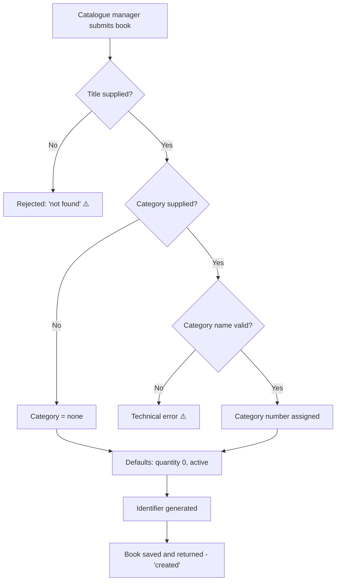
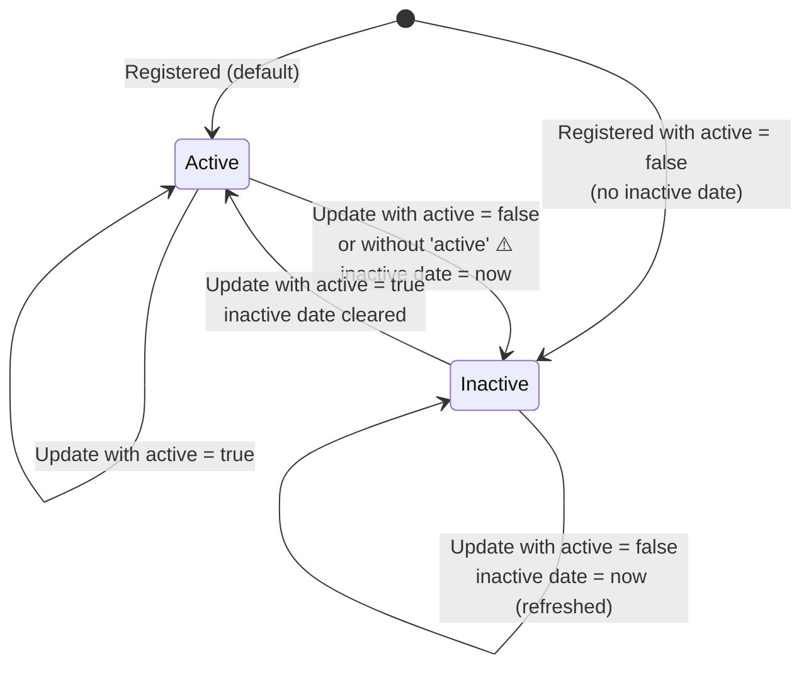

# Bookstore Inventory – Functional Documentation

| | |
|---|---|
| **Audience** | Product Owners, Business Managers, QA and anyone who needs to understand *what* the system does without reading code |
| **Scope** | Bookstore Inventory API, version 0.1.0 (current Java implementation) |
| **Status** | Describes the system **as it behaves today**. Behaviour that is probably unintended is flagged with ⚠️ and listed in [§8](#8-current-limitations-and-business-risks). |
| **Related** | [OpenAPI specification](../../src/main/resources/openapi/openapi.yaml) · [Technical documentation](../technical/technical-documentation.md) · [Known issues](../technical/known-issues.md) |

---

## 1. Purpose

The Bookstore Inventory service is the bookstore's single record of **which books it sells,
how many copies are in stock, and whether each book is currently offered for sale**.

Other systems, such as a shop front, a back-office tool or a stock-taking app, connect to it to:

* show the catalogue, optionally narrowed to one category;
* look up the details of one book;
* register a new title in the catalogue;
* update the stock after a delivery, a sale or a stock-take;
* withdraw a book from sale, or bring it back.

The service has no user interface; it exposes an HTTP API. An interactive page for trying out the
API is available at `/api/docs` (see [§9](#9-how-to-try-it)).

## 2. Actors

| Actor | Description | Typical actions |
|-------|-------------|-----------------|
| **Catalogue manager** | Maintains the list of titles. | Register new books. |
| **Stock clerk** | Receives deliveries and performs stock-takes. | Update quantities. |
| **Merchandiser** | Decides what is on sale. | Activate or deactivate books. |
| **Storefront / client application** | Shows the catalogue to customers or staff. | List books, filter by category, look up a book. |
| **Operations** | Keeps the service running. | Check service health. |

> There is **no login**. Any person or system that can reach the service can perform every action
> (see BR-40).

## 3. Glossary

| Term | Meaning |
|------|---------|
| **Book** | One title in the catalogue, e.g. *Test Driven Development* by Kent Beck. A book is a title, not an individual physical copy. |
| **Book identifier (id)** | A 24-character code generated by the system when a book is registered, e.g. `6ad0a37e801711241dd358c9`. It never changes. |
| **Category** | One of six fixed genres a book belongs to (see [§4](#4-reference-data-categories)). A book has at most one category. |
| **Stock / quantity** | Number of copies the store holds for a book. |
| **Active book** | A book that is offered for sale. |
| **Inactive book** | A book that has been withdrawn from sale. It stays in the catalogue, together with the date it was withdrawn (*inactive date*). |
| **Publisher / publication date** | Publishing house and date of publication of the edition. |
| **Catalogue** | The full list of books, both active and inactive. |

## 4. Reference data: categories

The list of categories is **fixed**. It cannot be changed through the API; a change requires a new
software release.

| Category name | Category number |
|---------------|-----------------|
| Fiction | 1 |
| Non-Fiction | 2 |
| Science | 3 |
| Biography | 4 |
| Children | 5 |
| Programming | 6 |
| *(no category)* | 0 |

* When **registering** a book or **filtering** the catalogue, the category is given by its
  **name**, spelled exactly as above (capitals matter: `Fiction`, not `fiction`).
* When the system **returns** a book, the category is shown by its **number**.

## 5. Information held about a book

| Information | Mandatory | Can be changed later? | Notes |
|-------------|-----------|-----------------------|-------|
| Identifier | Generated by the system | No | |
| Title | **Yes** | No | Duplicates are allowed. |
| Author | No | No | Free text, a single author. |
| Category | No | No | One of the six categories. |
| Quantity in stock | No (default 0) | **Yes** | |
| Description | No | No | Free text. |
| Language | No | No | Free text, e.g. "English". |
| Active | No (default: active) | **Yes** | |
| Inactive date | Automatic on deactivation | Automatic | |
| Publisher | No | No | |
| Publication date | No | No | Date **and time with time zone** must be given. |

> ⚠️ Only **quantity** and **active** can be changed once a book is registered. To correct a typo in a
> title, author or category, a new book has to be registered. Books **cannot be deleted**.

## 6. Business rules

### 6.1 Browsing the catalogue

| ID | Rule |
|----|------|
| BR-01 | The catalogue lists **all** books, both active and inactive. |
| BR-02 | Books are listed in the order they were registered. There is no sorting, paging or search by keyword. |
| BR-03 | The catalogue can be narrowed to **one category** by giving its exact name. |
| BR-04 | ⚠️ If the category name is not recognised (misspelled, wrong capitals, empty), the filter is **ignored** and the **whole catalogue** is shown. The user is not told that the filter failed. |
| BR-05 | A recognised category with no books gives an empty list. |
| BR-06 | Books registered without a category are shown only in the unfiltered catalogue. |

### 6.2 Looking up one book

| ID | Rule |
|----|------|
| BR-10 | A book can be looked up by its **exact title** (capitals and spaces must match). |
| BR-11 | If several books share the same title, the one registered first is returned. |
| BR-12 | ⚠️ Looking up a book by its **identifier does not work**: no book is ever found. |
| BR-13 | ⚠️ Looking up a book by **author** is not available yet; the request fails with a technical error. |
| BR-14 | ⚠️ When no book matches, the answer is "success" with an **empty result**, not "not found". Client applications must treat an empty result as "not found". |

### 6.3 Registering a new book

| ID | Rule |
|----|------|
| BR-20 | The **title is mandatory**. Without it the book is rejected. ⚠️ The rejection is reported as "not found" instead of "invalid request". |
| BR-21 | An empty title (`""`) is accepted. |
| BR-22 | The system generates the identifier. Any identifier supplied by the caller is ignored. |
| BR-23 | If no quantity is given, the stock starts at **0**. Negative quantities are accepted. |
| BR-24 | If no availability is given, the book is **active**. |
| BR-25 | The category must be one of the six names exactly as written in §4. ⚠️ An unknown category causes a technical error instead of a clear validation message. |
| BR-26 | If no category is given, the book is registered **without a category** (category 0). |
| BR-27 | Registering a book as inactive does **not** record an inactive date automatically (unlike BR-33). |
| BR-28 | Dates (publication, inactive) must include a time and time zone, e.g. `2002-11-08T00:00:00Z`. ⚠️ A plain date like `2002-11-08` causes a technical error. |
| BR-29 | The same title can be registered several times. |

### 6.4 Updating stock and availability

| ID | Rule |
|----|------|
| BR-30 | An update targets a book by its **identifier**, which is mandatory. ⚠️ A missing identifier is reported as "not found". |
| BR-31 | An update always sets **both** the quantity and the availability (active / inactive). |
| BR-32 | ⚠️ **If availability is not supplied, the book becomes inactive.** If the quantity is not supplied, the stock becomes **0**. Callers must always send both values. |
| BR-33 | When a book is made inactive, the system records the current date and time as its **inactive date**. |
| BR-34 | When a book is made active again, the inactive date is cleared. |
| BR-35 | Other information (title, author, category…) sent with an update is ignored. |
| BR-36 | ⚠️ Updating an identifier that does not exist reports **success**, but nothing changes. |
| BR-37 | ⚠️ The update reports "created" even though nothing new is created, and the confirmation only shows the identifier, quantity and availability; to see the full book, look it up again. |

### 6.5 Cross-cutting rules

| ID | Rule |
|----|------|
| BR-40 | No authentication: everyone with network access can read and change the inventory. |
| BR-41 | Errors carry no explanatory message. Callers only get the status code, and technical errors return a generic web page. |
| BR-42 | The health check confirms that the service is running, but **not** that the database is reachable. |
| BR-43 | If the database is unavailable, every catalogue operation fails after about 30 seconds. |

## 7. Use cases

### UC-01: Browse the catalogue

**Actor:** Storefront · **Trigger:** A user opens the catalogue page.

1. The client requests the catalogue, optionally with a category name.
2. The system returns the matching books with all their details.

```gherkin
Scenario: Filter by an existing category
  Given the catalogue contains "Test Driven Development" in Programming and "Dune" in Fiction
  When I list books with category "Programming"
  Then I receive only "Test Driven Development"

Scenario: Misspelled category shows the whole catalogue (current behaviour)
  When I list books with category "programming"
  Then I receive every book in the catalogue

Scenario: Category without books
  When I list books with category "Science"
  Then I receive an empty list
```

### UC-02: Look up a book

**Actor:** Storefront / staff · **Trigger:** A user opens a book's detail page.

```gherkin
Scenario: Book found by exact title
  When I look up the title "Test Driven Development"
  Then I receive its full details

Scenario: Title not found (current behaviour)
  When I look up the title "test driven development"
  Then the request succeeds with an empty result

Scenario: Search by author (not available)
  When I look up a book with author "Kent Beck"
  Then the request fails with a technical error
```

### UC-03: Register a new book

**Actor:** Catalogue manager · **Trigger:** A new title is added to the range.



```gherkin
Scenario: Register a complete book
  When I register "Test Driven Development" by "Kent Beck" in "Programming" with 3 copies
  Then the book is created with a new identifier
  And its category number is 6 and it is active

Scenario: Register with title only
  When I register a book with title "Minimal"
  Then it is created active, with 0 copies and no category

Scenario: Missing title
  When I register a book without a title
  Then the request is rejected
```

### UC-04: Update stock after a delivery or stock-take

**Actor:** Stock clerk

```gherkin
Scenario: Restock an active book
  Given "Test Driven Development" is active with 3 copies
  When I update it with quantity 10 and active true
  Then it has 10 copies and stays active

Scenario: Forgetting the availability flag (current behaviour)
  Given "Dune" is active
  When I update it with quantity 5 only
  Then it has 5 copies
  And it becomes inactive with today's inactive date
```

### UC-05: Withdraw a book from sale / bring it back

**Actor:** Merchandiser



Books are never deleted; inactive books remain visible in the catalogue (BR-01).

### UC-06: Check that the service is up

**Actor:** Operations. Calling the health check returns "OK" while the service is running (see BR-42).

## 8. Current limitations and business risks

| # | Limitation | Business impact | Ref. |
|---|------------|-----------------|------|
| 1 | Forgetting the availability flag on a stock update **takes the book off sale**. | Books silently disappear from sale; lost revenue. | BR-32 |
| 2 | Looking up a book by identifier never finds it. | Client applications must use titles, which are not unique. | BR-12 |
| 3 | Search by author is not available. | A requested feature is still missing. | BR-13 |
| 4 | A misspelled category shows the whole catalogue. | Customers see unrelated books; the error goes unnoticed. | BR-04 |
| 5 | Updating a non-existent book reports success. | Stock changes can be lost without anyone noticing. | BR-36 |
| 6 | Only quantity and availability can be changed; no deletion. | Data-entry mistakes cannot be corrected. | §5 |
| 7 | Negative stock and empty titles are accepted. | Inconsistent inventory data. | BR-21, BR-23 |
| 8 | No authentication. | Anyone on the network can change stock. | BR-40 |
| 9 | Error answers carry no explanation. | Users and support staff cannot tell what went wrong. | BR-41 |
| 10 | The health check does not cover the database. | Outages are detected late. | BR-42 |
| 11 | The README mentions deleting books, but this is not possible. | Misleading expectations. | — |

The technical root cause and proposed fix for each item are in
[known-issues.md](../technical/known-issues.md).

## 9. How to try it

1. Start the service: `docker compose up -d --build`.
2. Open **http://localhost:8080/api/docs** in a browser.
3. Expand an operation, click **Try it out**, adjust the example and click **Execute**.
