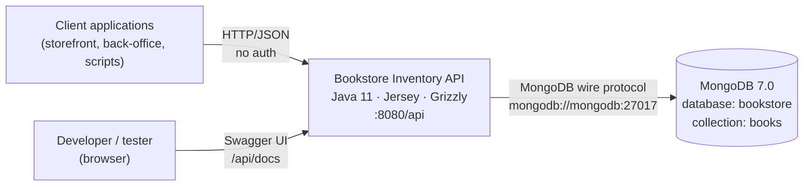
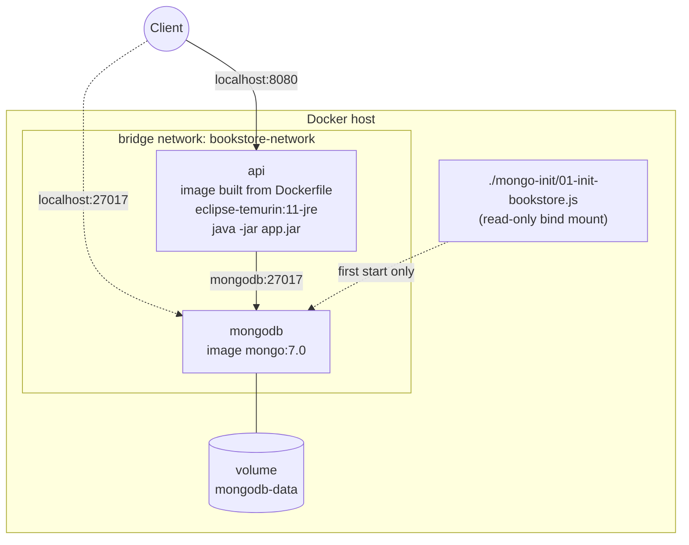
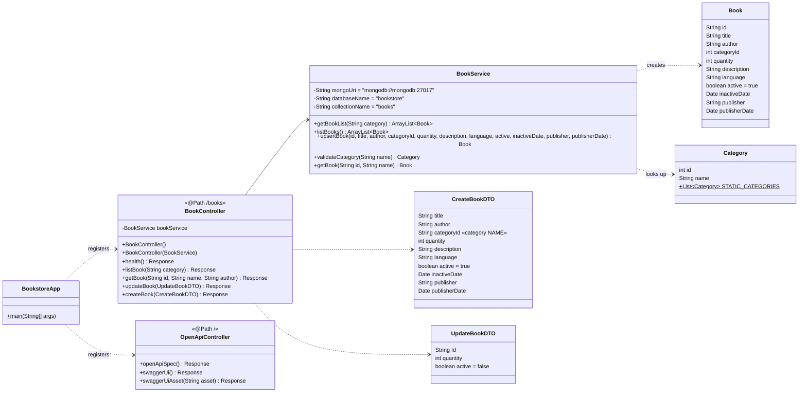
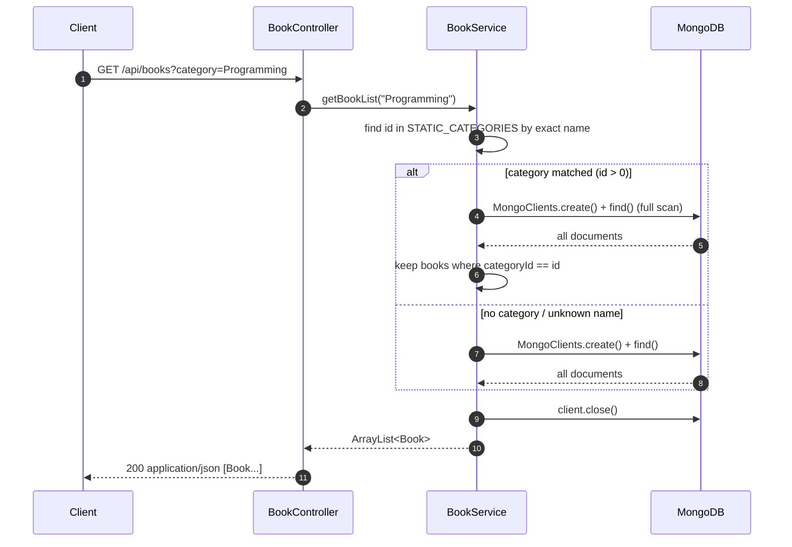
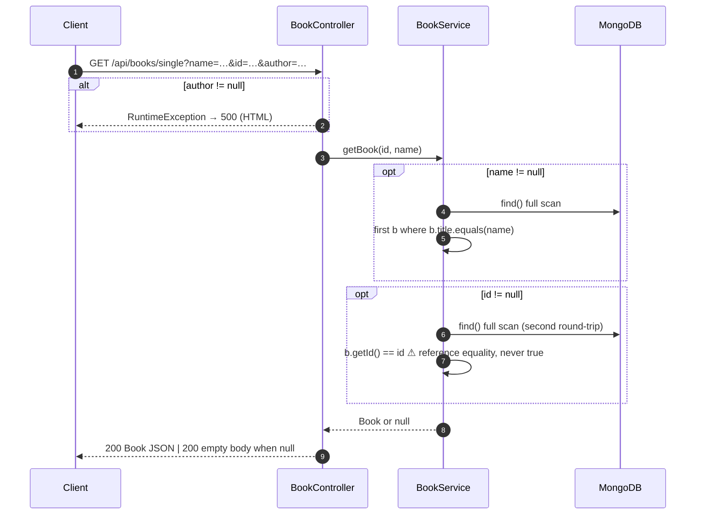
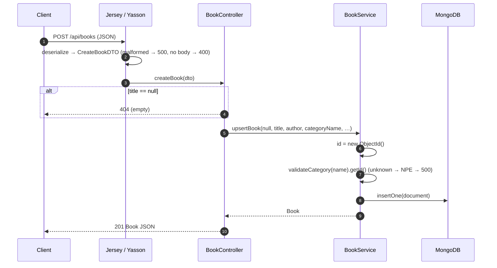
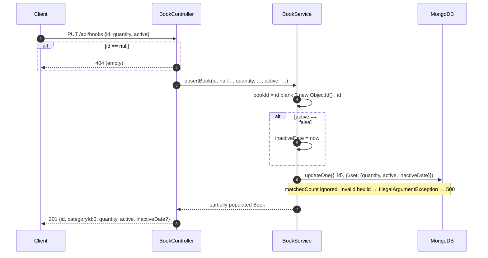

# Bookstore Inventory – Technical Documentation

| | |
|---|---|
| **Audience** | Developers, architects, DevOps and the team re-implementing the service in .NET |
| **Scope** | Current Java implementation, `bookstore-java` 0.1.0-SNAPSHOT |
| **Related** | [OpenAPI 3.1 spec](../../src/main/resources/openapi/openapi.yaml) · [Functional documentation](../functional/functional-documentation.md) · [Known issues](known-issues.md) · [Smoke tests](smoke-tests.http) |

---

# Part 1: High-Level Design

## 1.1 System context



The service is a stand-alone REST API with a single downstream dependency (MongoDB). It neither
calls other services nor publishes events.

## 1.2 Containers and deployment



| Component | Technology | Port | Notes |
|-----------|------------|------|-------|
| `api` | Java 11 (Temurin JRE), fat jar built by `maven-shade-plugin` | 8080 | `depends_on: mongodb` only orders start-up; it does not wait for readiness. `MONGODB_URI` is set but **ignored** by the code (KI-29). |
| `mongodb` | MongoDB 7.0 | 27017 (published to the host) | Data persisted in the `mongodb-data` volume. The init script runs only when the volume is empty. |

The image is built in two stages (`Dockerfile`):

1. `maven:3.8.6-eclipse-temurin-11`: `mvn dependency:go-offline`, then `mvn package -DskipTests`.
2. `eclipse-temurin:11-jre-jammy`: copies `target/bookstore-java-0.1.0-SNAPSHOT.jar` as `app.jar`.

## 1.3 Technology stack

| Concern | Library / tool | Version |
|---------|----------------|---------|
| Language / runtime | Java (source and target 11) | 11 |
| REST framework | Jakarta RESTful Web Services (JAX-RS) API | 3.1.0 |
| JAX-RS implementation | Eclipse Jersey (`jersey-container-grizzly2-http`, `jersey-hk2`) | 3.1.0 |
| HTTP server | Grizzly (embedded) | 4.0.0 |
| JSON binding | Jersey JSON-B media module → Eclipse Yasson | 3.1.0 |
| Database driver | `mongodb-driver-sync` | 4.11.0 |
| API documentation UI | `org.webjars:swagger-ui` | 5.25.3 |
| Build | Maven, `maven-shade-plugin` (fat jar), JaCoCo 0.8.10 | — |
| Tests | JUnit Jupiter 5.9, Mockito 5.12 | — |

## 1.4 Key design characteristics

* **Layering:** Controller (JAX-RS resource) → Service (business logic and data access) → MongoDB.
  There is no separate repository layer, domain layer or mapping layer.
* **Stateless:** No session or cache; each request reads from or writes to MongoDB directly, so the
  service can in principle be scaled horizontally.
* **Synchronous and blocking:** Requests are processed on Grizzly worker threads.
* **No dependency injection:** Objects are created with `new`; HK2 is only used internally by Jersey.
* **Configuration is hard-coded:** base URI `http://0.0.0.0:8080/api/`, Mongo URI, database and
  collection names.
* **Reference data in code:** The category list is a static Java list, not read from the database.
* **Cross-cutting concerns that are missing:** authentication, validation, exception mapping, logging framework,
  metrics, CORS, graceful shutdown.

## 1.5 API surface

Full contract: [`openapi.yaml`](../../src/main/resources/openapi/openapi.yaml), served at runtime as
`GET /api/openapi.yaml` and rendered at `GET /api/docs`.

| Method | Path | Handler | Purpose |
|--------|------|---------|---------|
| GET | `/api/books/health` | `BookController.health` | Liveness probe |
| GET | `/api/books?category=` | `BookController.listBook` | List or filter books |
| GET | `/api/books/single?id=&name=&author=` | `BookController.getBook` | Find one book |
| POST | `/api/books` | `BookController.createBook` | Register a book |
| PUT | `/api/books` | `BookController.updateBook` | Update stock / availability |
| GET | `/api/openapi.yaml` | `OpenApiController.openApiSpec` | OpenAPI document |
| GET | `/api/docs` | `OpenApiController.swaggerUi` | Swagger UI page |
| GET | `/api/docs/{asset}` | `OpenApiController.swaggerUiAsset` | Swagger UI static files |

---

# Part 2: Low-Level Design

## 2.1 Project structure

```text
bookstore-kata-dotnet/
├── pom.xml                         Maven build (dependencies, shade, JaCoCo)
├── Dockerfile                      Multi-stage image build
├── docker-compose.yml              api + mongodb stack
├── redocly.yaml                    OpenAPI lint configuration
├── mongo-init/
│   └── 01-init-bookstore.js        Seeds the (unused) `categories` collection
├── docs/
│   ├── functional/functional-documentation.md
│   └── technical/
│       ├── technical-documentation.md   (this file)
│       ├── known-issues.md
│       └── smoke-tests.http
└── src/
    ├── main/
    │   ├── java/com/bookstore/
    │   │   ├── BookstoreApp.java              Entry point: starts Grizzly + Jersey
    │   │   ├── controller/
    │   │   │   ├── BookController.java        JAX-RS resource /books
    │   │   │   ├── CreateBookDTO.java         POST request body
    │   │   │   ├── UpdateBookDTO.java         PUT request body
    │   │   │   └── OpenApiController.java     Serves openapi.yaml and Swagger UI
    │   │   ├── model/
    │   │   │   ├── Book.java                  Book entity / response body
    │   │   │   └── Category.java              Category + static reference list
    │   │   └── service/
    │   │       └── BookService.java           Business logic + MongoDB access
    │   └── resources/openapi/
    │       └── openapi.yaml                   OpenAPI 3.1 contract (single source of truth)
    └── test/java/com/bookstore/controller/
        ├── BookControllerTest.java            Controller unit test (Mockito)
        └── OpenApiControllerTest.java         Documentation endpoint tests
```

## 2.2 Class diagram



## 2.3 Start-up

`BookstoreApp.main`:

1. Builds a Jersey `ResourceConfig` that registers `JsonBindingFeature`, `BookController` and `OpenApiController`.
2. Calls `GrizzlyHttpServerFactory.createHttpServer(URI.create("http://0.0.0.0:8080/api/"), rc)`.
   The `/api` prefix comes from this URI. The `@ApplicationPath("/api")` annotation on the class
   has no effect in this embedded set-up.
3. Returns. The JVM stays alive because Grizzly's threads are non-daemon. There is no shutdown hook.

Because classes are registered (not instances), Jersey instantiates `BookController` **per request**
through its no-argument constructor, which creates a new `BookService` each time.

## 2.4 Request processing per endpoint

### GET /books: list and filter



### GET /books/single: find one book



### POST /books: create



### PUT /books: update stock and availability



`$set` always writes `inactiveDate`. When reactivating, the value is `null`, which clears the stored
date.

### Documentation endpoints

`OpenApiController` reads files from the classpath:

| Route | Source | Content-Type |
|-------|--------|--------------|
| `/api/openapi.yaml` | `openapi/openapi.yaml` (from `src/main/resources`) | `application/yaml` |
| `/api/docs` | Inline HTML that boots Swagger UI against `/api/openapi.yaml` | `text/html` |
| `/api/docs/{asset}` | `META-INF/resources/webjars/swagger-ui/<version>/<asset>` from the webjar | Derived from the extension |

The Swagger UI version is read at runtime from the webjar's `pom.properties`, so upgrading the
dependency in `pom.xml` needs no code change. Asset names are restricted to
`[A-Za-z0-9][A-Za-z0-9._-]*` and must not contain `..`, which prevents path traversal. Because the
assets come from the jar, the UI works **offline**.

## 2.5 Data model and persistence

**Database** `bookstore` · **Collection** `books` · Created implicitly on the first insert. No indexes
other than `_id`.

| Mongo field | BSON type | Java (`Book`) | JSON (response) | Written by |
|-------------|-----------|---------------|-----------------|------------|
| `_id` | ObjectId | `String id` (hex) | `id` | POST |
| `title` | string / null | `String title` | `title` | POST |
| `author` | string / null | `String author` | `author` | POST |
| `categoryId` | int32 (0–6) | `int categoryId` | `categoryId` | POST |
| `quantity` | int32 | `int quantity` | `quantity` | POST, PUT |
| `description` | string / null | `String description` | `description` | POST |
| `language` | string / null | `String language` | `language` | POST |
| `active` | bool | `boolean active` | `active` | POST, PUT |
| `inactiveDate` | date / null | `Date inactiveDate` | `inactiveDate` | POST, PUT |
| `publisher` | string / null | `String publisher` | `publisher` | POST |
| `publisherDate` | date / null | `Date publisherDate` | `publisherDate` | POST |

Example stored document:

```json
{
  "_id": { "$oid": "6ad0a37e801711241dd358c9" },
  "title": "Test Driven Development",
  "author": "Kent Beck",
  "categoryId": 6,
  "quantity": 3,
  "description": "A book about TDD",
  "language": "English",
  "active": true,
  "inactiveDate": null,
  "publisher": "Addison-Wesley",
  "publisherDate": { "$date": "2002-11-08T00:00:00Z" }
}
```

Reading (`listBooks`) defaults a missing `quantity` or `categoryId` to `0` and a missing `active` to
`false`.

**Seed script:** `mongo-init/01-init-bookstore.js` creates a `categories` collection
(`{id, name}`, unique index on `id`) with the same six values as `Category.STATIC_CATEGORIES`. The
application never reads it (KI-18).

**Connection management:** `MongoClients.create(uri)` is called for **each** service method
invocation and closed at the end. A client is leaked if an exception occurs before `close()`. The
driver's default server-selection timeout (30 s) applies when the database is unreachable.

## 2.6 JSON serialisation (Yasson defaults)

| Aspect | Behaviour |
|--------|-----------|
| Property naming | Derived from getters (`getId()` → `id`). The PUT field `Id` is therefore exposed as `id`, and the JSON key is case-sensitive. |
| Property order | Alphabetical. |
| Nulls | Omitted on output. |
| Unknown properties | Ignored on input. |
| `java.util.Date` output | `yyyy-MM-ddTHH:mm:ss[.SSS]Z[UTC]` |
| `java.util.Date` input | ISO-8601 with offset or zone (`…Z`, `…+02:00`, `…Z[UTC]`). Date-only or offset-less input fails. |
| Primitives (`int`, `boolean`) | Missing values take the Java default (`0`, `false`), or the field initialiser (`CreateBookDTO.active = true`). |

## 2.7 Error handling

No `ExceptionMapper` is registered, so errors follow Jersey's and Grizzly's defaults:

| Source | Example | Result |
|--------|---------|--------|
| Explicit `Response.status(...)` | Missing title / id | `404`, empty body |
| Missing entity | Empty POST / PUT body | `400`, empty body |
| Content negotiation | Wrong `Content-Type` / `Accept` | `415` / `406`, empty body |
| Routing | `DELETE /api/books` | `405` with `Allow` header |
| Any `RuntimeException` | NPE, `IllegalArgumentException`, `JsonbException`, `MongoTimeoutException` | `500`, Grizzly HTML page, `Connection: close`, stack trace logged to stdout |

## 2.8 Configuration

| Setting | Value | Where | Overridable |
|---------|-------|-------|-------------|
| Listen address | `0.0.0.0:8080` | `BookstoreApp` | No |
| Base path | `/api/` | `BookstoreApp` | No |
| Mongo URI | `mongodb://mongodb:27017` | `BookService` | No (`MONGODB_URI` ignored) |
| Database / collection | `bookstore` / `books` | `BookService` | No |
| Categories | 6 fixed entries | `Category.STATIC_CATEGORIES` | No |

Because the Mongo host is the Compose service name `mongodb`, the jar only works inside the Compose
network unless the host name is resolvable from where it runs.

## 2.9 Security

* No authentication or authorisation (`security: []` in the OpenAPI spec).
* No CORS headers, so browser apps on another origin cannot call the API.
* No input validation or size limits beyond Grizzly defaults.
* MongoDB runs without credentials and its port is published to the host.
* Error pages do not leak stack traces to clients, but full traces are written to the container logs.

## 2.10 Observability

* Logging goes to stdout through `java.util.logging` (Jersey / Grizzly) plus one `System.out.println` at start-up.
* There are no structured logs, trace ids, metrics or readiness probe.
* `GET /api/books/health` is a liveness check only.

---

# Part 3: Build, Run and Test

## 3.1 Prerequisites

* Docker with Compose v2. This is enough for everything below.
* Optional for running without Docker: JDK 11+ and Maven 3.8+.

## 3.2 Run

```bash
docker compose up -d --build
# API         http://localhost:8080/api/books
# Swagger UI  http://localhost:8080/api/docs
# OpenAPI     http://localhost:8080/api/openapi.yaml
docker compose logs -f api
docker compose down          # add -v to wipe the database volume
```

## 3.3 Test

```bash
# With local Maven
mvn test                      # unit tests
mvn verify                    # + JaCoCo report in target/site/jacoco/index.html

# Without local Java/Maven (same image as the Dockerfile)
docker run --rm -v "$PWD:/app" -v bookstore-m2:/root/.m2 -w /app \
  maven:3.8.6-eclipse-temurin-11 mvn -B test
```

Current suite: `BookControllerTest` (1 test) and `OpenApiControllerTest` (6 tests).

End-to-end behaviour: run [`smoke-tests.http`](smoke-tests.http) with the VS Code REST Client or the JetBrains HTTP Client
against the running stack.

## 3.4 Validate the API contract

```bash
npx @redocly/cli lint          # uses redocly.yaml
npx @redocly/cli build-docs src/main/resources/openapi/openapi.yaml -o target/api-docs.html
```

Any change to `BookController`, the DTOs or `Book` **must** be reflected in `openapi.yaml`.

---

# Part 4: Notes for the .NET re-implementation

The [company guidelines](../../COMPANY_GUIDELINES.md) target .NET 10 Minimal APIs. Suggested mapping:

| Java today | .NET 10 target |
|------------|----------------|
| `BookController` (JAX-RS) | `MapGroup("/api/v1/books")` with `async Task<IResult>` handlers and a `CancellationToken` |
| DTO classes with mutable primitives | `record` DTOs with nullable properties, so a missing value is distinguishable from `false` or `0` (fixes KI-01) |
| `BookService` + `MongoClients.create` per call | `IBookRepository` over a singleton `IMongoClient` registered in DI |
| Static `Category` list | Configuration or the existing `categories` collection |
| Grizzly HTML 500s | `AddProblemDetails()` + `TypedResults` (RFC 7807) |
| Static `openapi.yaml` | `Microsoft.AspNetCore.OpenApi` at `/openapi/v1.json` + Scalar UI; use this spec as the baseline for a contract-diff check |
| Hard-coded URIs | `appsettings.json` + environment variables (`MONGODB_URI`) |

Use [`known-issues.md`](known-issues.md) as the checklist of behaviours to change on purpose, and
the as-is spec to keep backward compatibility wherever the behaviour is kept.
