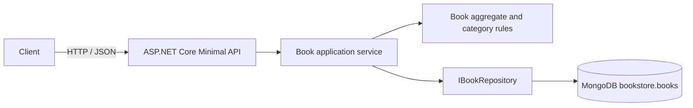

# Bookstore Inventory — Technical Documentation

| | |
|---|---|
| **Audience** | Developers, architects, and operations |
| **Scope** | Current .NET 10 Minimal API and MongoDB deployment |
| **Migration baseline** | [Java 0.1 OpenAPI contract](../../docs/openapi/openapi.yaml) and [known issues](known-issues.md) |

## 1. Architecture



The Book is the aggregate root and its own consistency boundary. `Book` owns registration and stock/availability invariants. `BookService` validates queries and coordinates the repository; `IBookRepository` is implemented by the MongoDB adapter. HTTP request and response records are separate from the aggregate. No domain events are published because there are no event consumers or external side effects.

```text
Bookstore.sln
├── Directory.Packages.props
├── Bookstore.Api/
│   ├── Contracts/       Immutable request and response DTO records
│   ├── Endpoints/       Minimal API route groups and handlers
│   ├── Application/     BookService and repository/service contracts
│   ├── Domain/          Book aggregate, categories, business validation
│   ├── Infrastructure/  MongoDB repository, ObjectId generator and indexes
│   ├── Middleware/      RFC 7807 exception handling
│   ├── Validation/      FluentValidation request validators
│   └── Program.cs       DI, JSON, logging, OpenAPI and middleware
└── Bookstore.Tests/     xUnit unit and integration tests
```

## 2. API and OpenAPI

The service uses route groups and Minimal API handlers under `/api/v1/books`; URI segments use plural nouns and kebab-case. Handlers are asynchronous and accept/forward cancellation tokens. Request/response DTOs are immutable C# records with primary constructors.

| Method | Route | Success | Error statuses documented |
|---|---|---|---|
| GET | `/health` | `200` | `503` |
| GET | `/api/v1/books` | `200` | `400`, `500` |
| GET | `/api/v1/books/{id}` | `200` | `400`, `404`, `500` |
| POST | `/api/v1/books` | `201` with `Location` | `400`, `415`, `500` |
| PATCH | `/api/v1/books/{id}` | `200` | `400`, `404`, `415`, `500` |

ASP.NET Core generates OpenAPI 3.1 at `/openapi/v1.json` in every environment. Scalar UI is mapped at `/scalar/v1` outside production. FluentValidation validates API request records before application services run; aggregate rules are also enforced in the domain. The API currently has no authentication; this absence is documented in the endpoint metadata and OpenAPI descriptions. Errors use Problem Details, include the trace ID, and do not expose stack traces. Serilog writes JSON logs with a per-request trace scope, and responses include `X-Trace-Id`.

The static `docs/openapi/openapi.yaml` is retained as the Java 0.1 as-is contract for migration comparison; it is not the current .NET API description. Do not use it to generate current clients.

## 3. Persistence and performance

- `IMongoClient` is registered once as a singleton; MongoDB's connection pool is reused across requests.
- Repository reads and writes use MongoDB's asynchronous driver methods and propagate request cancellation.
- Category, title, and author filters are applied in MongoDB, not after loading the collection into application memory.
- Every list query is ordered by ObjectId and bounded by `Skip`/`Limit`; default page size is 50, maximum is 100.
- Startup idempotently creates compound indexes for `(categoryId, _id)`, `(title, _id)`, and `(author, _id)`. MongoDB's built-in `_id` index handles direct id lookups.
- Stock changes use one atomic `FindOneAndUpdate` by ObjectId and return the post-update document. This avoids a read/replace race and prevents concurrent partial updates from overwriting unrelated fields.
- Database name and collection name are configurable. The `MONGODB_URI` environment variable overrides the local default.
- Mongo server-selection timeout is three seconds. `/health` pings the database and reports `503` when it cannot be reached.
- The adapter explicitly maps the legacy BSON `_id` and lower-camel-case fields. Existing book documents do not require a data migration. New ids use MongoDB ObjectId generation so ordering remains aligned with registration time.

## 4. Error handling, security, and operations

Validation failures and malformed JSON return `400` Problem Details; unsupported media types return `415`; missing records return `404`; health failures return `503`; unexpected failures return a generic `500`. Status-code pages also format routing errors as Problem Details. Trace ids are attached to error instances and logs.

There is no authentication or authorization requirement specified for this migration, so anonymous access is preserved and reported as unresolved KI-33. Do not expose the unauthenticated API or MongoDB to untrusted networks. MongoDB is only exposed on the Compose network; only the API port is published by Compose. The ASP.NET Core host manages shutdown and accepts `ASPNETCORE_URLS` configuration.

## 5. Build, run, and test

```bash
dotnet restore Bookstore.sln
dotnet build Bookstore.sln --no-restore
dotnet test Bookstore.sln
docker compose up --build
```

The solution uses root `Directory.Packages.props` for NuGet Central Package Management. The test project runs xUnit unit tests with mocked repository dependencies, `WebApplicationFactory<Program>` tests with an in-memory repository, and a real MongoDB 7 integration test using Testcontainers. The Testcontainers test requires Docker.

Coverlet is enabled by default for `dotnet test`; a total **70% line-coverage threshold** is enforced for `Bookstore.Api`. Only generated OpenAPI support code is excluded. The latest verified full run reported 96.39% line coverage. The report is at `Bookstore.Tests/coverage.json`.

Run the executable API examples in [smoke-tests.http](smoke-tests.http) against the running Compose stack. MongoDB data is kept in the `mongodb-data` Docker volume; stopping the stack does not delete it.
